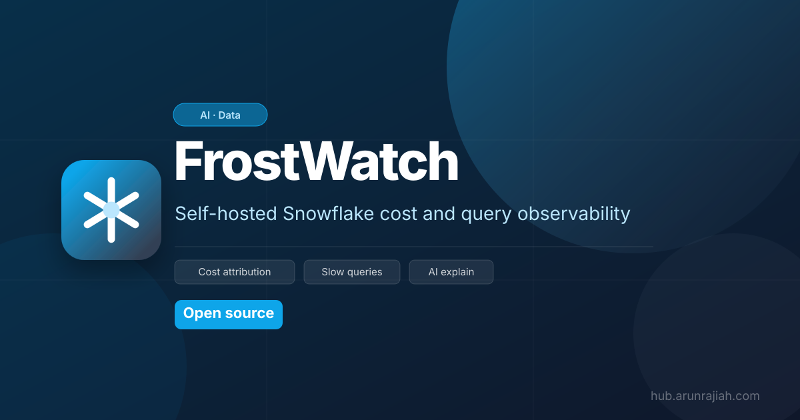
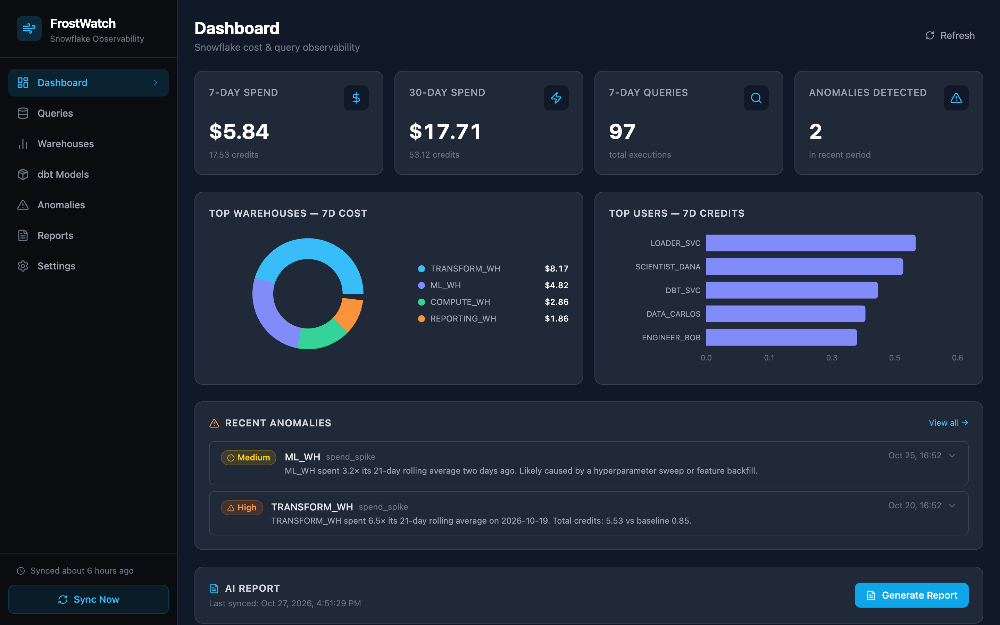
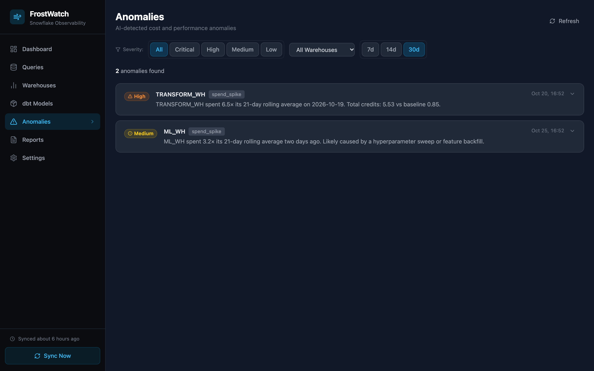
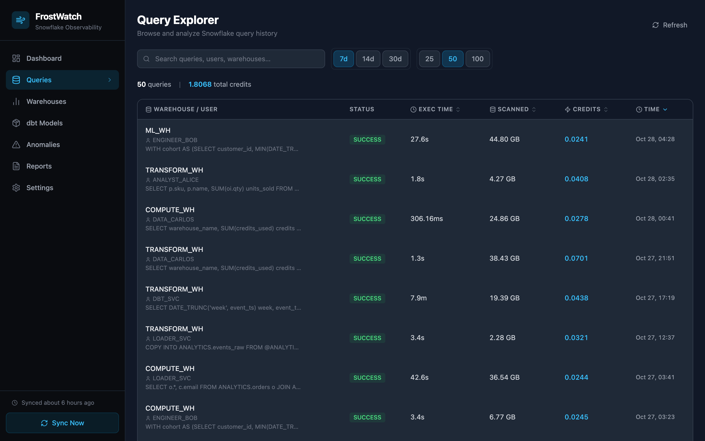

<p align="center">
  
</p>

<p align="center">
  
</p>

# ❄️ FrostWatch

**Snowflake cost monitoring shouldn't cost more than the savings.**

[](https://github.com/arunrajiah/frostwatch/actions/workflows/ci.yml)
[](https://pypi.org/project/frostwatch/)
[](https://www.python.org/downloads/)
[](https://ghcr.io/arunrajiah/frostwatch)
[](LICENSE)
[](https://github.com/sponsors/arunrajiah)
[](https://github.com/arunrajiah/frostwatch/stargazers)

FrostWatch is an open source, self-hosted cost and query observability tool for Snowflake. Snowflake's built-in Cost Management can now tell you *that* spend spiked. FrostWatch tells you **which dbt model, query pattern, and user** caused it, rewrites the expensive SQL, and generates the resource monitors to cap it. It runs in your own infrastructure, works with your own LLM (including a fully local one), and costs nothing: no SaaS contract, no percentage-of-spend pricing, no phone-home.



> *Cost breakdown by warehouse, anomaly detection, and AI-powered explanations, all in one dashboard.*

| Anomalies | Query Explorer |
|---|---|
|  |  |

## Try it in 30 seconds (no Snowflake needed)

```bash
pip install frostwatch
frostwatch demo
# → open http://localhost:8000
```

`frostwatch demo` seeds the local database with 35 days of realistic synthetic data - warehouse cost trends, dbt model breakdowns, injected anomaly spikes, AI explanations, pre-baked query rewrites, and a weekly digest - so you can explore the full UI before connecting a real Snowflake account.

## Why FrostWatch

**vs. Snowflake's built-in Cost Management (free):** Snowflake now does anomaly detection and AI explanations natively, and for simple spike alerts on one account that is enough. FrostWatch adds what it doesn't cover:

- Cost per **dbt model**, dbt Cloud job, and environment, plus a cost summary posted on your **pull requests**
- **Query fingerprinting** and week-over-week regression detection, so you see the SQL *pattern* driving spend, not one query at a time
- **AI query rewrites** that return optimized SQL, clustering suggestions, and estimated savings
- **Resource monitor sizing** from your actual p95 spend, with ready-to-run `CREATE RESOURCE MONITOR` DDL
- Per-user and per-role **budgets**, and a weekly digest to Slack or email

**vs. SELECT and other paid tools (from $1,499/month or a percentage of spend):**

- **Free and MIT licensed.** Your savings stay savings.
- **Self-hosted.** Query history never leaves your network. Outbound calls go only to Snowflake, the LLM you choose (with Ollama, even that stays local), and any Slack, email, or dbt Cloud integration you turn on.
- **Read-only.** FrostWatch recommends and generates SQL; it never changes your warehouses on its own.
- **Auditable.** Every query it runs against `ACCOUNT_USAGE` is in this repo.

**When to pick something else:** if you need multi-account rollups today (FrostWatch is single-account until v0.5) or automatic warehouse tuning, a paid tool fits better. If you only want spike alerts on one account, Snowflake's built-in tools are enough.

*Comparison based on public docs as of October 2026. Spot something out of date? Open an issue.*

## What it does

**Find what's driving spend**

- **Cost breakdown** by warehouse, user, role, and query tag, updated on a schedule you control
- **dbt model attribution**: per-model credit, USD cost, and performance parsed from `query_tag`
- **dbt Cloud integration**: run metadata, cost by job and environment, model spend threshold alerts, and manifest.json enrichment (owner, description, materialization, tags)
- **Query fingerprinting**: group near-identical queries by SQL pattern and surface the patterns that drive the most spend
- **Week-over-week regression detection**: flag query patterns that got more expensive this week (medium / high / critical severity)

**Fix it**

- **AI query rewrites**: send any expensive query to your LLM and get back optimized SQL, root-cause analysis, clustering recommendations, and estimated savings %
- **Plain-English explanations** of anomalies and expensive queries, powered by your own LLM (Anthropic, OpenAI, Gemini, or a local Ollama model)
- **Resource monitor management**: sync existing monitors, recommend quotas from p95 spend, generate copy-paste `CREATE RESOURCE MONITOR` DDL

**Keep it fixed**

- **GitHub Actions**: post a dbt cost summary and threshold alerts as a PR comment after every `dbt run`
- **Anomaly detection** against a rolling 21-day baseline
- **Budget tracking**: per-user and per-role daily credit budgets with over-budget flagging
- **Cost forecasting**: per-warehouse credit projections for the next 1 to 30 days
- **Alerts** when a warehouse approaches its resource monitor limit
- **Weekly digests** delivered to Slack or email

**Use it your way:** dark-themed web UI (no BI tool required), a REST API at `/api/*`, and a CLI for sync, config, and server management.

Coming from Chaos Genius? See the [migration guide](https://arunrajiah.github.io/frostwatch/chaos-genius-alternative/).

## Quickstart

### Option A - Docker (recommended)

```bash
# 1. Copy and edit the config
curl -O https://raw.githubusercontent.com/arunrajiah/frostwatch/main/frostwatch.yaml.example
cp frostwatch.yaml.example frostwatch.yaml
# Edit frostwatch.yaml with your Snowflake credentials and LLM API key

# 2. Start
docker compose up -d

# 3. Open the UI
open http://localhost:8000
```

### Option B - pip

```bash
pip install frostwatch

# Initialize config
frostwatch config init
# Edit ~/.frostwatch/config.yaml with your credentials

# Start the server
frostwatch serve
```

### Option C - from source

```bash
git clone https://github.com/arunrajiah/frostwatch
cd frostwatch

# Install Python package in editable mode
pip install -e ".[dev]"

# Build the frontend
cd frontend && npm install && npm run build && cd ..

# Initialize config
frostwatch config init

# Run
frostwatch serve --reload
```

## Configuration

All config lives in `~/.frostwatch/config.yaml`. Every field can also be set via environment variable with the `FROSTWATCH_` prefix.

```yaml
snowflake_account: "xy12345.us-east-1"
snowflake_user: "FROSTWATCH_USER"
snowflake_password: "your_password"
snowflake_role: "ACCOUNTADMIN"       # needs SELECT on ACCOUNT_USAGE

llm_provider: "anthropic"            # anthropic | openai | gemini | ollama
llm_api_key: "sk-ant-..."

slack_webhook_url: "https://hooks.slack.com/services/..."
email_recipients: ["ops@example.com"]

schedule_cron: "0 8 * * 1"          # weekly digest - Monday 8am
sync_cron: "0 */6 * * *"            # data sync - every 6 hours
credits_per_dollar: 3.0              # adjust for your Snowflake contract rate
snowflake_query_limit: 500           # queries fetched per sync
```

See [`frostwatch.yaml.example`](frostwatch.yaml.example) for the full reference.

## Snowflake permissions

FrostWatch only reads from `SNOWFLAKE.ACCOUNT_USAGE`. The minimum required grant:

```sql
-- Create a dedicated role (recommended)
CREATE ROLE frostwatch_role;
GRANT IMPORTED PRIVILEGES ON DATABASE SNOWFLAKE TO ROLE frostwatch_role;
GRANT ROLE frostwatch_role TO USER your_user;
```

The `ACCOUNTADMIN` role already has this access. No data is ever written to Snowflake.

## LLM providers

| Provider | `llm_provider` | Default model |
|---|---|---|
| Anthropic (Claude) | `anthropic` | `claude-sonnet-4-6` |
| OpenAI | `openai` | `gpt-4o` |
| Google Gemini | `gemini` | `gemini-2.0-flash` |
| Ollama (local) | `ollama` | `llama3` - set `llm_base_url` to your Ollama server |

FrostWatch is BYO-LLM. Your data never passes through a hosted proxy - it goes directly from your server to the LLM provider using the API key you supply.

## CLI reference

```
frostwatch demo              Seed synthetic data and start server - no Snowflake needed
frostwatch serve             Start the web server (default: http://localhost:8000)
frostwatch serve --reload    Start with auto-reload for development
frostwatch sync              Run a one-off Snowflake sync
frostwatch config init       Create ~/.frostwatch/config.yaml from the example
frostwatch config show       Print current config (secrets masked)
frostwatch version           Print version
```

## API

The REST API is available under `/api`. Interactive docs are at `http://localhost:8000/docs` when the server is running.

Key endpoints:

| Method | Path | Description |
|---|---|---|
| `GET` | `/api/dashboard` | Cost summary + recent anomalies |
| `GET` | `/api/queries` | Top queries by credit usage |
| `GET` | `/api/warehouses` | Per-warehouse cost aggregates |
| `GET` | `/api/anomalies` | Detected anomalies with LLM explanations |
| `GET` | `/api/dbt` | Credit + cost breakdown by dbt model |
| `GET` | `/api/insights/fingerprints` | Top query patterns by total credits |
| `GET` | `/api/insights/regressions` | Query patterns that regressed week-over-week |
| `GET` | `/api/insights/forecasts` | Per-warehouse cost projections (7-day) |
| `GET` | `/api/insights/pruning` | Query patterns with poor partition pruning |
| `POST` | `/api/insights/rewrites` | Request an AI rewrite for a query |
| `GET` | `/api/insights/rewrites/{query_id}` | Fetch a previously generated rewrite |
| `GET` | `/api/dbt/runs` | dbt Cloud runs with cost attribution |
| `GET` | `/api/dbt/jobs` | Cost breakdown by dbt Cloud job |
| `GET` | `/api/dbt/environments` | Cost breakdown by dbt Cloud environment |
| `GET` | `/api/dbt/threshold-alerts` | Models that exceeded daily credit threshold |
| `GET` | `/api/dbt/metadata` | Enriched model metadata from manifest.json |
| `POST` | `/api/dbt/sync-cloud` | Sync run metadata from dbt Cloud API |
| `POST` | `/api/dbt/manifest` | Upload and parse a dbt manifest.json |
| `GET` | `/api/resource-monitors` | Synced Snowflake resource monitors |
| `GET` | `/api/resource-monitors/recommendations` | Quota recommendations per warehouse |
| `GET` | `/api/resource-monitors/generate-sql` | Copy-paste DDL for a warehouse |
| `GET` | `/api/resource-monitors/proximity-alerts` | Monitors near their credit limits |
| `GET` | `/api/resource-monitors/budgets` | Per-user and per-role spend vs budget |
| `POST` | `/api/sync` | Trigger a manual Snowflake sync |
| `GET` | `/api/settings` | Current configuration |
| `PUT` | `/api/settings` | Update configuration |
| `POST` | `/api/settings/test-snowflake` | Test Snowflake connectivity |
| `POST` | `/api/reports/generate` | Generate an AI cost report |

## Architecture

```
┌─────────────┐     read-only     ┌──────────────────────────────────┐
│  Snowflake  │ ◄───────────────  │  frostwatch serve                │
│ ACCOUNT_    │                   │                                  │
│ USAGE views │                   │  FastAPI + APScheduler           │
└─────────────┘                   │  ├── /api/*  (REST)              │
                                  │  └── /       (React SPA)         │
┌─────────────┐                   │                                  │
│  LLM API    │ ◄───────────────  │  SQLite  (local cache + history) │
│ (your key)  │                   └──────────────────────────────────┘
└─────────────┘
```

FrostWatch runs entirely inside your infrastructure. The only outbound calls are to Snowflake and your chosen LLM provider.

## Roadmap

See [ROADMAP.md](ROADMAP.md).

## Sponsors

FrostWatch is free, MIT-licensed, self-hosted, and solo-maintained. It runs on your infrastructure with your LLM key - no SaaS contract, no percentage-of-spend pricing, no phone-home.

**For data teams running FrostWatch in production:** sponsorship is the sustainable replacement for paid FinOps tooling. A $500/month org sponsorship is roughly **1% of what Select.dev charges to monitor a $50k/month Snowflake spend**, and it funds the project for everyone - including smaller teams and non-profits who can't justify either.

**Sponsorship currently funds:**

- Multi-account support (currently single-account; tracked in [ROADMAP.md](ROADMAP.md))
- Snowflake-native scheduled task migration helpers
- Expanded forecasting models beyond linear regression (seasonality, change-point detection)
- Direct integrations with PagerDuty / Opsgenie for real-time alerts

**Suggested tiers:**

- **$25/month (individual)** - keeps the project alive; shoutout in the next release notes
- **$100/month (team)** - priority issue triage + roadmap input
- **$500/month (org)** - your logo in the README + a quarterly call to discuss your team's Snowflake workflows

**Who should sponsor:** data engineering teams at companies running Snowflake, Snowflake consulting partners whose engagements include cost optimization, FinOps practices using FrostWatch in client work, and anyone whose Snowflake bill has surprised them in the last quarter.

[](https://github.com/sponsors/arunrajiah)

<!-- sponsors --><!-- sponsors -->

## Contributing

Contributions are welcome! Please open an issue before starting large changes so we can align on direction.

- Read [CONTRIBUTING.md](CONTRIBUTING.md) for setup instructions and PR guidelines
- Follow our [Code of Conduct](CODE_OF_CONDUCT.md)
- All PRs require passing CI (lint, type check, tests, frontend build) and one maintainer review

## License

[MIT](LICENSE) - free to use, modify, and self-host. See the license file for details.

