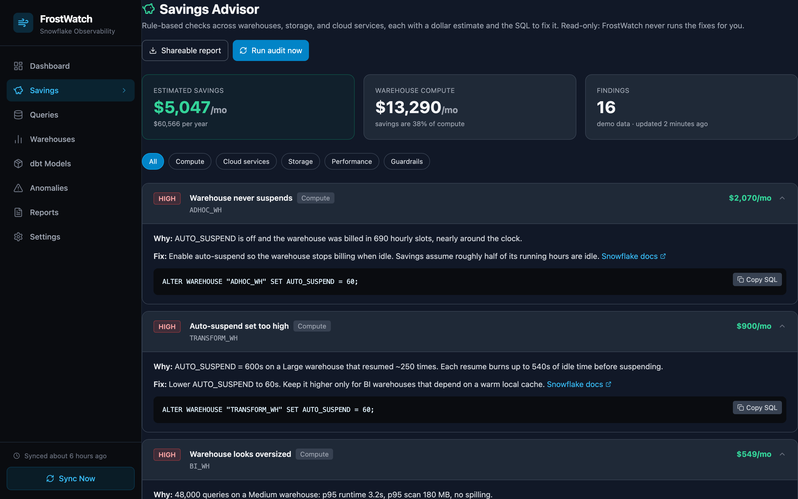

# Savings Advisor and `frostwatch audit`

Find out how much your Snowflake account is overspending in about a minute. No server, no config file, no LLM key. Read-only.

```bash
pip install frostwatch          # or: uvx frostwatch audit ...
frostwatch audit --connection my_snowflake
```

You get a ranked list of findings in the terminal and a shareable HTML report (`frostwatch-audit.html`) with a dollar estimate and copy-paste fix SQL for each one. [See a sample report](sample-audit.html){ .md-button }



## Connecting

Pick whichever matches how you already log in:

| You use | Command |
|---|---|
| Snowflake CLI / `connections.toml` | `frostwatch audit -c <connection_name>` |
| SSO (Okta, Azure AD, ...) | `frostwatch audit -a <account> -u <user>` (opens your browser) |
| Key-pair service user | `frostwatch audit -a <account> -u <user> --private-key rsa_key.p8` |
| Password (no MFA) | `SNOWFLAKE_PASSWORD=... frostwatch audit -a <account> -u <user> --authenticator snowflake` |
| Just looking | `frostwatch audit --demo` |

Add `--role` if your default role cannot read `SNOWFLAKE.ACCOUNT_USAGE`. The minimum grant is:

```sql
GRANT DATABASE ROLE SNOWFLAKE.USAGE_VIEWER TO ROLE <your_role>;
```

## What it checks

| Check | Category | How savings are estimated |
|---|---|---|
| Auto-suspend higher than 60s | Compute | (auto_suspend minus 60s) x resumes x credits/hour |
| Warehouse never suspends | Compute | 50 percent of the warehouse's spend |
| Oversized warehouse (Medium+, p95 under 10s, under 1 GB scanned, no spill) | Compute | 30 percent of the warehouse's spend |
| Identical query re-run without hitting the result cache | Compute | 50 percent of its runtime cost |
| Cloud services billed above the free 10 percent | Cloud services | 50 percent of the billed amount |
| Time Travel and Fail-safe larger than the table | Storage | Fail-safe plus 80 percent of Time Travel bytes x $/TB |
| Large table not read in 90 days (Enterprise) | Storage | Its active bytes x $/TB |
| Remote spilling | Performance | Flagged, no dollar estimate |
| Queuing (concurrency bound) | Performance | Flagged, no dollar estimate |
| Warehouse with no resource monitor | Guardrails | Flagged, with ready-made `CREATE RESOURCE MONITOR` SQL |
| Expensive automatic clustering | Compute | Cost shown for review |

Compute savings for one warehouse are capped at 70 percent of its spend so overlapping findings never double count. All estimates are directional: they are meant to rank where to look first, not to be quoted to finance to the cent.

## Options

```text
--days 30              History window (7 to 365)
--output report.md     .html (default), .md (paste into Slack or a GitHub issue), or .json
--price 2.40           Your contract price per credit (default 3.00)
--storage-price 23     USD per TB-month
--fail-over 500        Exit with code 2 if monthly savings exceed $500 (use in CI)
--no-open              Do not open the report in a browser
```

## In the web UI

When you run `frostwatch serve`, an audit runs after every scheduled sync and shows on the **Savings** page, with a **Run audit now** button and a link to the shareable report. API: `GET /api/advisor`, `POST /api/advisor/run`, `GET /api/advisor/report.html`, `GET /api/advisor/report.md`.

## Weekly audit in GitHub Actions

```yaml
name: Snowflake savings audit
on:
  schedule: [{ cron: "0 8 * * 1" }]
  workflow_dispatch:
jobs:
  audit:
    runs-on: ubuntu-latest
    steps:
      - run: echo "${{ secrets.SNOWFLAKE_PRIVATE_KEY }}" > key.p8
      - run: >
          pipx run frostwatch audit --no-open -o audit.md
          -a ${{ vars.SNOWFLAKE_ACCOUNT }} -u ${{ vars.SNOWFLAKE_USER }}
          --private-key key.p8 --role FROSTWATCH_ROLE
      - run: cat audit.md >> "$GITHUB_STEP_SUMMARY"
```

## No install at all

Can't install Python where you are? Paste the [Quick Audit SQL](quick-audit-sql.md) into a Snowsight worksheet instead.
